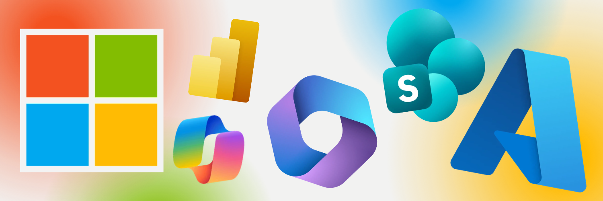

<h1 align="center">Microsoft Product UI Redesign (WIP)</h1>

  

A Project that is dedicated to redesigning Microsoft Products & Sites to practice my UI/UX design skills.

  <!-- <a href="#about">About</a> •
  <a href="#prerequisites">The API</a> •
  <a href="#links">Links</a> •
  <a href="#credits">Credits</a> -->

## About
This project is dedicated to redesigning Microsoft pages and sites. I have always appreciated what Microsoft does as a company and wanted to use their platforms to practice my UI/UX design skills. One area where Microsoft often struggles is consistency and avoiding bloat across their websites. I believe they have great products that can be made even better, so this serves as a fun project to reimagine their web presence.

## Why?
Having used Microsoft products extensively for both personal and professional work throughout my career, I appreciate how powerful their ecosystem is. However, it often lacks the seamless cohesion found in competing platforms like Apple or Google, which tend to deliver a more refined, premium experience. While Microsoft naturally prioritizes enterprise workflows, there is immense potential to elevate the consumer experience and bring that same polished feel to everyday users. Bringing this level of design to enterprise tools would also significantly boost overall quality.

While there is plenty of room for improvement across the board, such as refining the overall login flow, the UI and UX play a major part in delivering a cohesive feel. Design is the first thing people see.   

For example, the first thing I redesigned was the main Microsoft website. Currently, the first thing a visitor notices is the bloat. Every product Microsoft develops deserves its own marketing pages, but compiling them all at once adds unnecessary complexity. The last thing you want is to overwhelm a user. In the modern digital age, a cluttered interface or a slow page can easily drive a user away. Everyone already knows what Microsoft does, which is a massive advantage most companies do not share. Microsoft can use this brand recognition to its advantage by simplifying the user journey.   

## Directory & Links

| Product | Case Study | Status |
|-----|------|------|
| Main Website | N/A | Work In Progress |
| SharePoint | N/A | Work In Progress |

Each product I have redesigned includes a short case study detailing my design decisions and reasoning. My thought process might not be perfect, but this project is ultimately a learning experience.

## Notice
